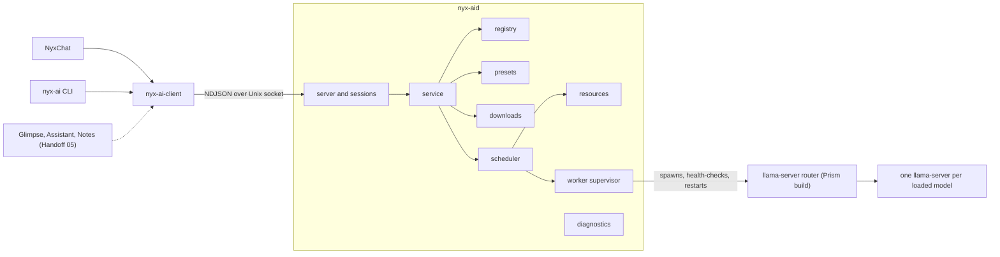

# Nyx AI Core architecture

Nyx AI Core is the one local model runtime for NyxOS. It is a headless user
service, `nyx-aid`, that owns the llama.cpp build, the shared model store,
downloads, load-time settings, memory budgeting and scheduling. Applications talk
to it through `nyx-ai-client` and keep their own conversations, prompts,
attachments, indexes and UI.

## Processes

- **`nyx-aid`** is started by systemd socket activation (`nyx-aid.socket`) the
  first time a client connects, or by `nyx-aid.service` directly. It never loads
  a model at startup.
- **The worker** is `llama-server` in router mode, spawned by `nyx-aid` in its
  own process group with the parent-death signal set. It listens on
  `$XDG_RUNTIME_DIR/nyx-ai/worker.sock` (inside the daemon's `0700` folder) and
  requires an API key generated per start. It runs with `--no-models-autoload`
  and no idle sleep, so models load and unload only when AI Core asks, and in
  llama.cpp's offline mode, so a load never contacts Hugging Face (see
  `PRISM.md`).
- **Model instances** are the router's children, one per loaded model. A crash
  in one takes down that model only; the router reports it as failed. A crash
  of the router is a worker crash.

## Crates

| Crate | Role |
|---|---|
| `nyx-ai-proto` | Versioned wire types: handshake, operations, events, replies, errors |
| `nyx-ai-client` | Async and blocking client: socket checks, handshake, streams, cancel, retry |
| `nyx-ai-core` | The daemon library (modules below) |
| `nyx-aid` | The daemon binary |
| `nyx-ai` | A CLI for status, models, downloads, settings and smoke tests |

`nyx-ai-core` modules:

- `paths`, `config`: XDG locations and `~/.config/nyx-ai/settings.toml`.
- `gguf`: reads GGUF headers (architecture, context length, pooling, chat
  template, file type) without loading weights.
- `registry`: the authoritative model list. It merges the router's `/models`
  with GGUF metadata, scans the read-only model folders, writes the router's
  preset file, persists `~/.local/state/nyx-ai/registry.json`, and reports
  states (`downloading`, `installed`, `loading`, `ready`, `busy`, `unloading`,
  `failed`, `missing`).
- `presets`: `~/.config/nyx-ai/models.ini`, the load-time settings per model
  (validated keys only; other keys are preserved).
- `downloads`: Hugging Face GGUF downloads into the shared HF hub cache with
  resume, SHA-256 checks, disk-space checks and one-at-a-time queueing.
- `resources`: RAM and VRAM, GPU backends present in the worker, memory
  pressure, and the memory a model needs.
- `scheduler`: leases, priority queues with aging, per-model concurrency,
  loading with eviction, pins ("keep loaded") and idle unloading.
- `worker`: the supervisor and the HTTP-over-Unix-socket client.
- `stream`: the router's SSE turned into ordered events.
- `service`: one handler per operation.
- `server`: the socket, peer checks, handshake, per-connection request tables.
- `diagnostics`: counters and averages without prompt or reply content.

## Ownership

| AI Core owns | Applications own |
|---|---|
| llama.cpp build and worker | Conversations, history, personas, prompts |
| Model store, downloads, removal | Attachments and their metadata |
| Load-time settings (context, offload, KV cache) | Sampling choices per request |
| Loading, unloading, eviction, pins | Which model a feature uses |
| Scheduling and priorities | Search indexes, ranking, RAG stores |
| Capability metadata | UI and app settings |

## Requests

1. A client connects, the daemon checks the peer is the same user and names it
   (`nyx-peer` for trusted programs, otherwise `untrusted:<declared name>`).
2. The client sends `hello` with its `api_version`; a mismatch is an explicit
   `incompatible_version` error.
3. Each request has a client-chosen `id`. Streams reply with `event` lines and
   end with exactly one `result` or `error` line for that `id`.
4. Inference requests take a lease on their model. The scheduler loads the model
   if needed (evicting idle ones within the budget), waits for a free slot by
   priority, and holds the lease until the reply ends. A leased model is never
   unloaded.
5. Cancelling (`cancel`, or closing the connection) drops the upstream request,
   which stops generation in the worker, and ends with `cancelled`.

## Scheduling policy

- Classes `interactive`, `normal`, `background`. Waiting requests age one class
  every 20 seconds, so background work is never starved.
- Background requests don't start while an interactive request is waiting.
- Per model, concurrency is capped by the instance's slot count.
- Ties go to the client with fewer requests running.
- Loading is serialised. Before a load, idle unpinned models are evicted
  least-recently-used first until the count (`max_loaded`) and the memory budget
  allow it; pinned idle models go last; models serving requests never go. If
  only busy models stand in the way, the load waits.
- Idle models unload after `idle_unload_seconds` (pins exempt). Under memory
  pressure (low `MemAvailable` or PSI), idle unpinned models unload early.

## Failure handling

- Worker crash: in-flight requests end with `worker_failed`; the supervisor
  restarts with backoff (1, 2, 4, 8, 16 s). After 5 crashes in 2 minutes it stops
  and reports `failed`; the next request after a minute tries again.
- Model load failure: `model_load_failed` with the router's exit code.
- Client disconnect: its requests are cancelled; its pins stay (they belong to
  the application, not the connection) until `unload_model`.
- Daemon restart: registry, presets and settings persist; nothing in flight
  resumes.

## Privacy

Logs and diagnostics carry model IDs, sizes, timings and counts, never prompts,
replies, embeddings input or attachments. Downloads only accept `.gguf` files
from Hugging Face, checked against their LFS SHA-256, and never run anything.
